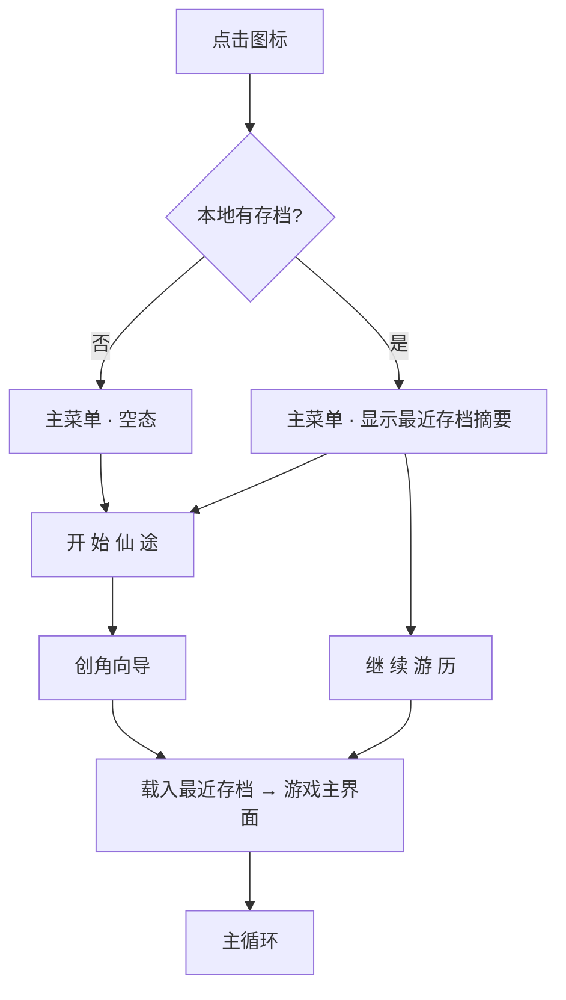
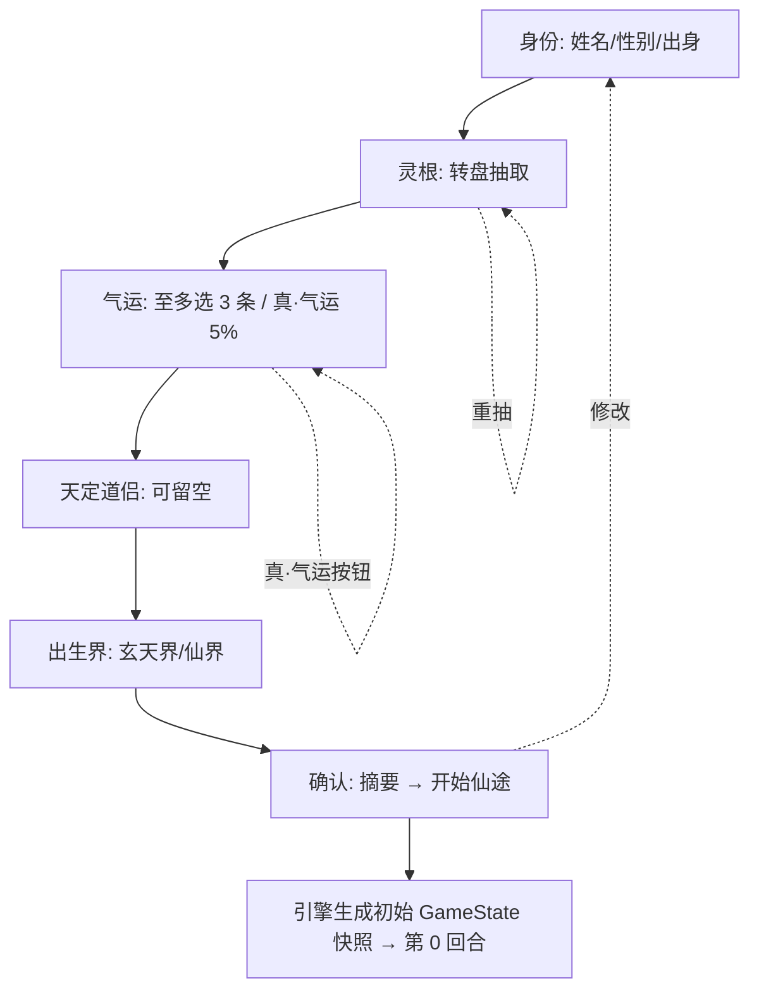
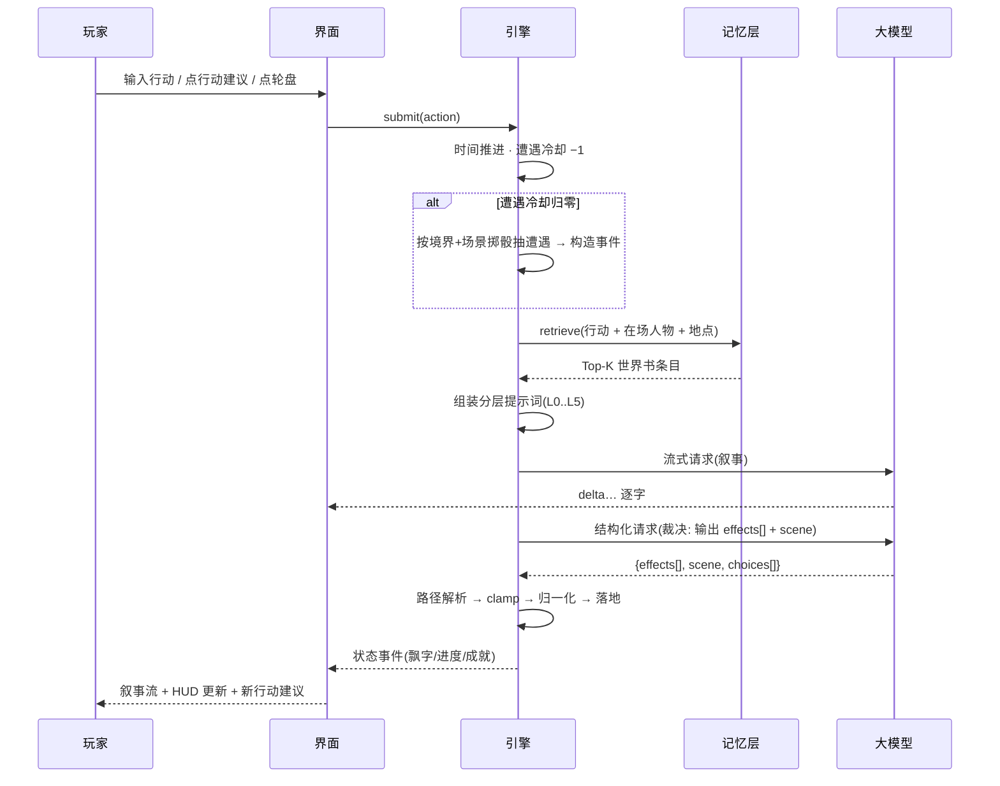
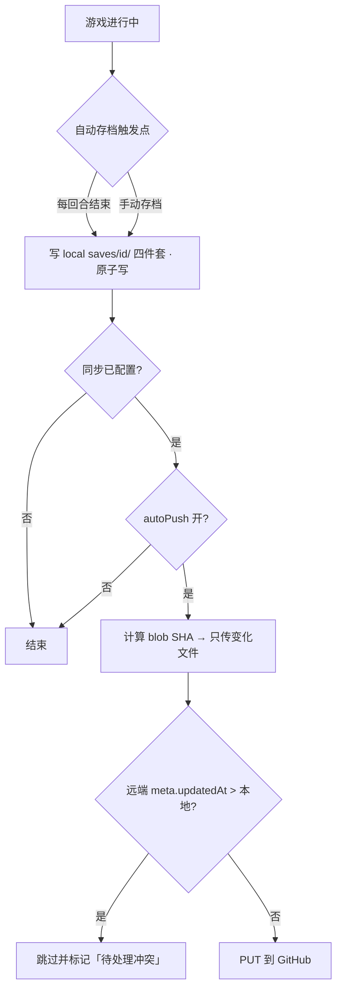
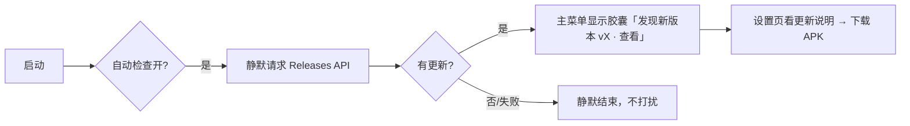

# 产品设计与交互流程

> 版本：v1.0　日期：2026-10-12
> 上游：[00 主方案](00-道渊独立版-产品设计方案.md)｜[01 安卓原型设计](01-道渊独立版-安卓原型设计.md)｜[03 应用架构与实现](03-应用架构与实现.md)
> 下游实现：[05 技术架构设计](05-技术架构设计.md)
> 本文回答：**用户从按下图标到长期游历，每一步看到什么、能做什么、出错怎么办。**

---

## 1. 产品定义（一句话与边界）

**一句话**：把《道渊》这张"提示词里的小游戏引擎"落成原生 App——**引擎管账本与规则，模型管演出与自由剧情**。

**输入**：玩家的一句行动（或从建议里点一个）。
**输出**：一段剧情 + 一次真实的状态变更 + 一个可继续的处境。

**明确不做**（本期）：多人/联网社交、排行榜、图形化战斗、图形地图、配音、商店/内购。

**核心承诺**（对玩家的三条硬保证）：

| 承诺 | 含义 | 怎么做到 |
|---|---|---|
| 数值不撒谎 | 界面上每个数字都由本地引擎算出 | 引擎算，模型只演 |
| 进度不丢 | 掉电、换设备、误操作都不丢档 | 原子写 + GitHub 同步 + 覆盖前备份 |
| 钥匙不外流 | API Key 只在本机 | 密钥与配置物理隔离，前端只见掩码 |

---

## 2. 用户与场景

| 角色 | 场景 | 关键诉求 |
|---|---|---|
| **老玩家**（玩过角色卡版） | 桌面长时沉浸 1–3 小时 | 别再掉档、界面别再是聊天气泡、设定别漏 |
| **同一位玩家的手机** | 通勤/睡前 10–20 分钟碎片推进 | 与桌面进度一致；单手可操作；弱网可用 |
| **新玩家** | 首次打开，不知道怎么开始 | 创角要引导，不要求他先懂"世界书" |

**前提**：玩家自带 LLM API（OpenAI 兼容 / 中转 / 本地 Ollama）。App 不内建付费模型。

---

## 3. 全局流程

### 3.1 冷启动



启动不做强制登录、不联网、不弹广告。**全程离线可用**，唯一出网是"检查更新"（可关）与"调用玩家自己的模型"。

### 3.2 首次配置（可选但强烈引导）


未配置时**不阻断**游戏：行动仍可执行，走离线示例文本，并在叙事区顶部常驻一条可关闭的提示条。

### 3.3 创角流程（6 步）



**每一步的规则**：

| 步 | 必填 | 默认 | 返回 | 跳过 |
|---|---|---|---|---|
| 身份 | 姓名、出身 | 姓名空则填「陆沉」，出身空则「宗门外门」 | 回主菜单 | — |
| 灵根 | 需抽取 | 未抽不可下一步（按钮置灰） | 上一步 | — |
| 气运 | 否（0–3） | 无 | 上一步 | 可直接下一步 |
| 道侣 | 否 | 留空=天道自定 | 上一步 | ✓ |
| 出生界 | 是 | 玄天界 | 上一步 | — |
| 确认 | — | — | 修改（回第 1 步） | — |

右上角 `»` = **跳过整段创角**，用全默认值快速开局（给老玩家）。

### 3.4 主循环（一回合的完整流程）



**关键点**：UI 在模型还没吐完时就已经在显示文字（流式），但**数值只在裁决结果回来后一次性落地**，避免"数字先跳再回滚"。

### 3.5 存档与同步



**冲突的人话解释**：两台设备都推进过同一个存档时，App **不会自动挑一个覆盖**，而是提示"远端更新于 X / 本机更新于 Y，先拉取还是先推送？"，并在覆盖前把被覆盖方备份成 `conflict-<时间戳>/`。

### 3.6 更新



---

## 4. 逐屏交互规格

> 通用约定：**空态**给下一步动作、**加载态**给进度感知、**错误态**给人话 + 重试入口。
> 触控目标 ≥ 44dp；所有可滚动区域禁用橡皮筋回弹；抽屉打开时背景不滚动。

### 4.1 主菜单

| 项 | 规格 |
|---|---|
| 目标 | 3 秒内让玩家知道"这是什么"并能开始 |
| 元素 | 鎏金书法字「道渊」；5 个按钮（开始仙途/继续游历/图鉴/设置/关于）；版本号；合规声明 |
| 状态 | **空态**：无存档时「继续游历」置灰并提示"尚无存档"；**有存档**：按钮副标题显示"最近：<地点> · <时间> · 第 N 回合" |
| 更新态 | 有新版本时，"关于本作"上方出现可点胶囊 |
| 交互 | 按钮按下缩放 0.98；背景双光斑缓慢漂移（`prefers-reduced-motion` 时静止） |
| 异常 | 无 |

### 4.2 创角向导

| 项 | 规格 |
|---|---|
| 布局 | 顶部步骤条（6 段）+ 标题 + 说明 + 表单 + 底部双按钮（平板限宽 720 居中） |
| 灵根抽取 | 点「抽取灵根」→ 转盘脉冲动画 900ms → 按概率表出结果：天 1% / 地 4% / 玄 15% / 黄 35% / 凡 45%。结果卡显示品阶 + 修炼产出 + 出现概率。可无限重抽 |
| 气运选择 | 卡片网格，点选切换；已选数实时显示"已选 N / 3"；超限不报错（忽略第 4 次点击）；「真·气运(5%)」按钮随机把一条普通气运升格为「真·」并置顶 |
| 校验 | 灵根未抽时「下一步」置灰且不可点 |
| 返回 | 左上 `‹`：第 1 步回主菜单，其余回上一步；右上 `»` 跳过整段 |
| 草稿 | 流程内状态保留在内存；**中途退出不保存**（不做草稿，避免半成品档） |

### 4.3 游戏主界面

这是停留时间最长的一屏，交互最密。

**布局（手机）**：HUD 顶栏 → 叙事流（唯一滚动区）→ 行动区（轮盘 + 自由输入）
**布局（平板 ≥700px）**：左导航栏 86px + 中栏叙事 + 右栏状态面板

| 区域 | 元素 | 交互 |
|---|---|---|
| **HUD 行1** | 姓名 · 境界(DC) · `☰` | `☰` 开抽屉（手机）/ 换右栏面板（平板） |
| **HUD 行2** | 时间 · 地点 · 天气 · 危机徽标 · 遭遇冷却 | 只读。危机四档变色：无/低(绿) 中(橙) 高(红) |
| **六维条** | 生命/精血/灵力/修为/神识/道心 | 手机 3×2，平板 6×1；变化时条上方飘字 `+6`/`-18`（1.3s 淡出上浮） |
| **场景横幅** | 当前时间/地点/危机 | 随最近回合更新，淡入 |
| **叙事流** | 助手气泡 / 玩家气泡 / 效果 chip / 行动建议 | 助手流式打字；效果 chip 绿(+)/红(−)；建议可点即发 |
| **行动轮盘** | 探索 修炼 突破 交流 玉简 地图 背包 面板 | 探索/修炼/突破高亮为「hot」；玉简/地图/背包直接开面板 |
| **自由输入** | 输入框 + 发送 | 回车发送；发送后清空并失焦（移动端收键盘） |

**模糊感知 vs 神视**（贴合卡设定）

- 默认：六维条只显示**模糊语**（充盈 ≥80 / 稳固 ≥30 / 不足 ≥20 / 枯竭 ≥10 / 濒危 ≥1 / 归零 0），数字隐藏。
- 设置里开「神视模式」后：条上显示精确数字（原型与截图用的就是这个模式，便于评审）。
- 这个开关**只影响显示**，不影响任何计算。

**危机程度**：无=不显示徽标；低/中/高 分别绿/橙/红。

### 4.4 13 个面板

统一规格：顶部面板名 + 关闭（手机）/无（平板右栏常驻）；tab 条切换；内容区独立滚动。

| 面板 | 默认态 | 空态 | 特殊交互 |
|---|---|---|---|
| **主角** | 头像+境界+宗门 → 六维 → 容貌形止 → 气运卡 → 功法器物 → 炼丹炼器 | 不会空 | 气运卡可展开看效果；器物显损耗度（>60% 变红） |
| **道侣** | 卡片流：立绘位 + 亲密心形 + 五维条 + 性格/外观/背景/神通 + 心声浮字 | "尚未结下道侣。机缘来时，天道自会安排。" | 心声用左侧冷紫竖线引用块 + 淡入模糊 |
| **人物** | 好感条 + 关系五阶阶梯（陌生→试探→松动→信任→至诚） | 同上风格 | 阶梯按阶段点亮；阵营色（后续） |
| **灵宠** | 亲密度/生命/灵力 + 心声 | "尚无灵宠。" | 小图标收集 |
| **机遇** | 任务卡（难度徽标/目标/机缘/引言） | "眼下无事。可外出走走。" | 最多 20 条；完成归档（后续） |
| **绝色榜** | 图鉴式卡片网格 | — | 未遇显示 `？？？` 半透明锁定；遇到即解锁 |
| **玉简** | 手机外形壳 + 聊天气泡 + 传讯输入 | 无联系人时提示 | 发消息 → 模型生成回信；保留最近 100 条 |
| **背包** | 图标网格 + 数量 + 描述 | "储物袋空空如也。" | 数量归零自动清理；器物区独立 |
| **地图** | 区域列表，已探索点亮（鎏金），未探索半透明锁 | — | 当前所在标「所在」；未探索不可点 |
| **图鉴** | 搜索框 + 条目卡 + `#标签` | "未找到「xx」相关条目。" | 搜索实时过滤；正文中的专有名词可点 |
| **模型** | 预设/地址/Key/模型/参数/测试 | — | Key 输入框回显掩码；浏览器内显示"需客户端"提示卡 |
| **同步** | 仓库/分支/目录/令牌 + 开关 + 两侧存档列表 | "本机暂无存档。" | 推送/拉取/全部推送；冲突时二次确认 |
| **设置** | 主题/神视/流式/缓存/提醒 + 版本与更新 + 安卓适配自检 | — | 更新检查按钮就地显示结果 |

### 4.5 判定 / 战斗演出（覆盖层）

| 项 | 规格 |
|---|---|
| 触发 | 行动轮盘点「突破」；剧情中的冲突由引擎判定后弹出 |
| 内容 | 双方 DC + 境界 + 境界差 → 引擎胜率 → 大字「胜/败」→ 压制阶梯描述 → 承认结果 |
| 计算 | 胜率 = clamp(50 − 境界差×3 + (道心−50)×0.3 + 灵力×0.2, 5, 92)，掷骰由引擎做 |
| 交互 | 覆盖层打开时背景模糊（`backdrop-filter`）；点「承认结果」关闭并把结果交给模型演战况 |
| 语义 | **面板上没有一个数字来自模型**——这是"引擎算、模型演"最直观的证据 |

---

## 5. 交互细节规范

### 5.1 返回键 / 返回手势层级（安卓）

```
抽屉打开        → 关抽屉
某面板打开      → 回叙事
判定覆盖层      → 不响应（必须点承认结果）
游戏主界面      → 「退出到主菜单？」
主菜单          → 「退出游戏？」（二次确认）
创角向导        → 上一子步骤 → 第 1 步再退回主菜单
```

### 5.2 键盘（桌面）

| 键 | 行为 |
|---|---|
| `Enter` | 发送自由输入 |
| `Esc` | 关抽屉 / 关判定覆盖层 / 关弹窗 |
| `1`–`6` | 选第 1–6 条行动建议 |
| `Tab` / `Shift+Tab` | 面板之间切换 |

### 5.3 手势（移动）

| 手势 | 行为 |
|---|---|
| 从右缘左滑 | 打开抽屉 |
| 抽屉内右滑 | 关闭抽屉 |
| 长按数值条 | 显示该维度的说明 tooltip |
| 长按气运 chip | 展开效果全文 |
| 下滑 | 叙事流回到底部（若已离开底部则先回底） |

### 5.4 动效清单

| 场景 | 动效 | 时长 |
|---|---|---|
| 数值变化 | 条上方飘字 + 条宽过渡 | 1.3s / 0.5s |
| 叙事流式 | 逐字出现 + 光标闪烁 | 随流 |
| 助手离线回退 | 一次性全文打字机 | ~640ms |
| 抽屉进出 | translateX | 280ms |
| 判定弹出 | scale 0.9→1 + 淡入 | 300ms |
| 心声浮字 | 上移 + 去模糊 | 500ms |
| 创角灵根 | 转盘脉冲 | 循环至出结果 |

`prefers-reduced-motion: reduce` 时全部降级为无动画。

---

## 6. 统一状态与错误处理

### 6.1 四态规范

| 态 | 表现 | 必须有 |
|---|---|---|
| 空态 | 灰字说明 + 一句"下一步可以做什么" | 引导语 |
| 加载态 | 骨架屏或"正在……"，超过 400ms 才出现（避免闪烁） | 可感知进度 |
| 错误态 | **人话**说明 + 具体原因 + 重试入口 | 不出现堆栈/英文码 |
| 禁用态 | 置灰 + 说明为何不可用 | tooltip 或副标题 |

### 6.2 错误话术对照

| 底层 | 玩家看到 |
|---|---|
| HTTP 401 | 接口拒绝了请求：API Key 可能不对或已失效 |
| HTTP 404（模型） | 找不到模型「xxx」，请在设置里重新选择 |
| 连接超时 | 连不上接口地址，检查网络或 base URL |
| 429 | 请求太频繁，稍后再试 |
| 模型返回非法 JSON | 模型这次没按要求返回，已忽略这次状态变更（剧情照常） |
| 同步 403 | 令牌没有该仓库的 Contents 读写权限 |
| 同步冲突 | 远端更新于 X，本机更新于 Y。先拉取还是先推送？ |

### 6.3 降级原则

任何外部依赖失败，**游戏本身不能停**：

- 模型失败 → 叙事回退离线文本；数值仍由引擎照常推进。
- 记忆检索失败 → 只注入常驻法则（L1），不硬塞、不报错。
- 同步失败 → 只提示，不阻断游玩；下次再试。
- 更新检查失败 → 静默。

---

## 7. 文案与术语规范

| 规范 | 说明 |
|---|---|
| 语气 | 第二人称"你"称呼玩家；NPC 对白用中文全角引号「」或 `""` |
| 术语统一 | 道心（非"心境"）、精血（非"气血"）、储物袋（非"背包"——但 UI 标签用"背包"更易读，**面板名用「背包」，正文用「储物袋」**） |
| 数值不给假精度 | 模糊模式下不会出现"生命 92"这种数字 |
| 系统提示 | 一律"是什么 + 怎么办"，不出现"错误码 500" |
| 模型相关 | 不在界面暴露 provider 内部术语（除设置页），不说"token""prompt" |

---

## 8. 可访问性

- 字号调节（3 档）：14 / 15 / 17px 基准。
- 对比度：正文 `#e8e6df` on `#0d1220` ≈ 14:1，远超 AA。
- 所有图标按钮带 `title`/`aria-label`。
- 键盘可达：所有交互元素可 Tab 到，焦点环可见。
- 动效可关（系统级 `prefers-reduced-motion`）。
- 不依赖颜色单独传达信息（危机程度同时有文字"低/中/高"）。

---

## 9. 验收用例

每个流程都要能过"happy path + 至少一条异常"。

| # | 用例 | 期望 |
|---|---|---|
| A1 | 全新安装 → 跳过创角 → 连续 20 次「探索」 | 每回合都有叙事；六维始终 0–100；无报错 |
| A2 | 未配模型时行动 | 走离线文本 + 顶部提示条；不弹错误弹窗 |
| A3 | 配了错误的 API Key | 叙事区显示"接口拒绝了请求：API Key 可能不对"；可重试 |
| B1 | 创角不抽灵根点下一步 | 按钮置灰，点不动 |
| B2 | 气运选满 3 条再点第 4 条 | 忽略，仍显示 3/3 |
| B3 | 创角中途按返回 | 逐步回退，第 1 步退回主菜单，不产生存档 |
| C1 | 数值到 100 后继续加 | clamp 在 100，不溢出 |
| C2 | 灵力归零后施法 | 引擎拒绝并给"灵力不足"，叙事说明原因 |
| D1 | 同一存档两端各推进后同步 | 明确提示冲突，覆盖前有 `conflict-*` 备份 |
| D2 | 令牌权限不足 | 提示缺 Contents 读写权限 |
| E1 | 手机竖屏 → 横屏 | 版式按宽度切换；当前面板与滚动位置保留 |
| E2 | 旋转后返回键 | 行为仍符合 5.1 层级 |
| F1 | 更新检查断网 | 静默；设置页显示"检查失败…（不影响离线游玩）" |
| G1 | 图鉴搜索"尸魔宗" | 命中相关条目并高亮标签 |
| G2 | 正文点专有名词 | 弹出该条目（后续） |

---

## 10. 与实现文档的对应

- 状态与规则契约 → [05 技术架构设计](05-技术架构设计.md) 第 3–5 节
- 面板数据来源 → 05 第 6 节（记忆层）与 05 第 5 节（引擎）
- 同步与冲突细节 → 05 第 10 节
- 构建与产物 → 05 第 13 节
