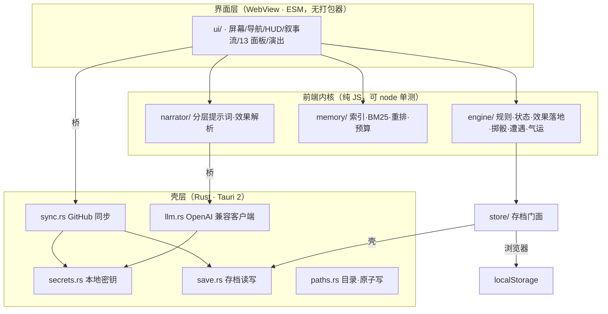
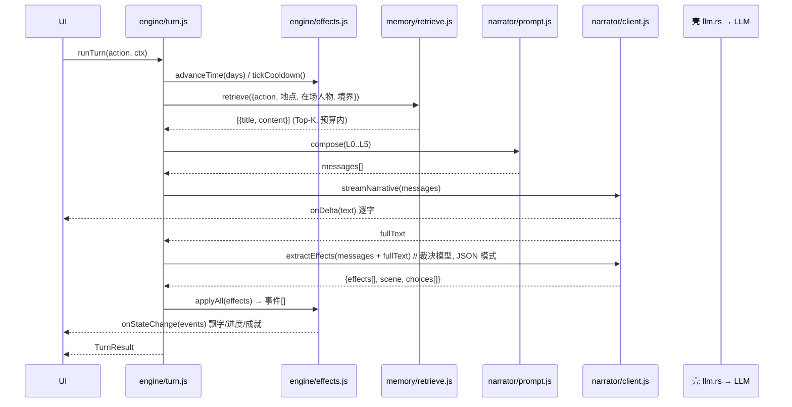

# 技术架构设计

> 版本：v1.0　日期：2026-10-12
> 上游：[04 产品设计与交互流程](04-产品设计与交互流程.md)｜[03 应用架构与实现](03-应用架构与实现.md)
> 本文回答：**代码怎么分层、模块边界在哪、接口长什么样、怎么测、怎么保证不掉档。**

---

## 1. 架构总览



**分层原则**：能本地算的绝不交给模型；界面层不含任何密钥；内核层不依赖 DOM、不依赖网络，纯函数为主。

**为什么前端不用打包器**：`frontendDist` 直指静态目录，零构建 = 安卓上不需要 Node 工具链、CI 不需要前端流水线、离线资源不会因构建漂移。代价是没有 tree-shaking 与 TS 类型检查，用 JSDoc + `node --test` 补齐可测性。

---

## 2. 目录与模块

```
prototype/
├── index.html          # 唯一页面；script type="module" 载入 main.js
├── styles.css
├── main.js             # 入口：装配依赖、启动界面
├── data.js             # 初始示例状态（创角前的占位）
├── update.js           # 检查更新（GitHub Releases）
├── bridge.js           # 前端 ↔ Rust 壳 的唯一通道
├── data/
│   └── worldbook.json  # 派生自 _卡资产提取/worldbook_full.json（tools/ 生成）
├── core/
│   ├── clamp.js        # clamp / 归一化 / 数值守卫
│   ├── rng.js          # 可注入随机源（测试固定种子）
│   └── types.js        # JSDoc typedef（GameState / TurnResult / Effect …）
├── engine/
│   ├── rules.js        # 境界DC表·压制阶梯·灵根加成·修炼·突破·道心四境
│   ├── state.js        # StateStore：不变量、归一化、快照/恢复
│   ├── effects.js      # 语义 effect → 落地（路径解析、clamp、frozen 字段）
│   ├── dice.js         # 胜率与掷骰
│   ├── encounter.js    # 遭遇冷却、场景分类、候选抽取
│   ├── fate.js         # 灵根品阶抽取、气运池抽取
│   └── turn.js         # 一回合编排：推进时间 → 检索 → 叙事 → 落地
├── memory/
│   ├── tokenize.js     # 中英混合分词
│   ├── bm25.js         # 打分
│   ├── index.js        # 建索引（常驻条目 + 倒排）
│   └── retrieve.js     # 召回 → 规则重排 → Top-K → token 预算裁剪
├── narrator/
│   ├── prompt.js       # L0..L5 分层编排（固定顺序，命中前缀缓存）
│   ├── client.js       # 包装 bridge：流式叙事 / JSON 裁决
│   └── parse.js        # effects/scene/choices 解析与容错
├── store/
│   ├── index.js        # DYStore 门面
│   ├── local.js        # localStorage 后端
│   └── shell.js        # Rust 后端（save_* commands）
├── sync/index.js       # 包装 DYApp.sync：状态、冲突交互
└── ui/
    ├── app.js          # 屏幕/导航/抽屉/HUD/叙事流/行动区
    ├── panels.js       # 13 个面板渲染 + 绑定
    ├── create.js       # 创角向导
    ├── judge.js        # 判定演出
    └── settings.js     # 设置与更新
tests/                  # node --test，只依赖内核模块（不碰 DOM、不连网）
├── engine.core.test.mjs      规则 / 状态归一化 / 效果落地 / 遭遇 / 时间 / 随机源
├── engine.turn.test.mjs      回合编排（桩 llm）、修炼与突破结算、降级路径
├── memory.retrieve.test.mjs  分词 / BM25 / 索引分层 / 重排 / 预算（用真实 319 条跑）
└── narrator.prompt.test.mjs  裁决解析容错 / 提示词分层与预算 / 前缀缓存前提
tools/
└── build-worldbook.mjs # _卡资产提取/worldbook_full.json → prototype/data/worldbook.json
```

---

## 3. 关键类型契约

以 [附录B](附录B·状态数据模型.md) 为准，运行时用 JSDoc 表达（`core/types.js` 只放注释）：

```ts
GameState { 世界, 主角, 道侣{}, 灵宠{}, 人物{}, 机遇{}, 绝色榜{}, 玉简{}, $器灵台词[] }
World     { 当前时间, 当前地点, 天气, 灵气, 危机程度, 遭遇冷却, 动向{} }
Protagonist { 姓名, 性别, 容貌, 身形, 衣着, 境界, 境界DC, 宗门, 宗门贡献, 所在界,
              生命, 精血, 灵力, 修为, 神识, 道心, 神念, 灵根, 状态,
              气运{}, 炼丹{}, 炼器{}, 储物袋{}, 功法{}, 器物{} }

Effect    = { op:'set'|'delta'|'add'|'remove', target:string, value:any, reason?:string }
TurnResult{ narrative:string, effects:Effect[], scene?:Scene, choices?:string[] }
Scene     = { 当前时间?, 当前地点?, 危机程度?, 天气?, 灵气? }
SaveMeta  { id, name, createdAt, updatedAt, saveVersion, summary, playtimeMs }
```

**不变量（引擎强制，任何写入路径都不能绕过）**

| 规则 | 实现位置 |
|---|---|
| `Pct ∈ [0,100]`，`NaN → 默认值` | `core/clamp.js` + `engine/effects.js` |
| `遭遇冷却 ∈ [0,15]` | 同上（按字段白名单给上限） |
| `储物袋` 数量 ≤0 剔除 | `engine/state.js::normalize` |
| `机遇` ≤20、`玉简.历史记录` ≤100 | 同上 |
| `境界` 格式 `"<大境界><小境界>（DC:n）"` | `engine/rules.js::realmLabel` |
| 道侣/NPC `性格` 首次写入后冻结 | `engine/state.js` frozen 集合 |

---

## 4. 一回合的时序（实现级）



**失败处理**：

| 环节 | 失败 | 退路 |
|---|---|---|
| 检索 | 抛错/空 | 只注入 L1 常驻法则，继续 |
| 叙事流 | 网络/超时 | 气泡显示人话错误；**数值照常推进**；提示可重试 |
| 裁决抽取 | JSON 非法 | 丢弃本次 effects，正文保留，记 `engineLog` |
| 落地 | 未知路径 | 该条跳过并记日志，其余照常落地 |

---

## 5. 引擎设计（纯函数优先）

### 5.1 `engine/rules.js`

```js
REALM_DC        // 全境界 DC 表（附录B）
DC_TIERS        // DC 差 → 压制阶梯
ROOT_GAIN       // 灵根品阶 × 境界段 → 单次修炼修为增量
REALM_ORDER     // 境界顺序，用于比较与"跨大境界"判断
realmLabel(name, idx) → "炼气三层（DC:3）"
cultivate(net, {root, realm, days}) → {修为增量, 耗时}
breakthroughChance(net, {道心, 灵根, 丹药}) → 0..1
daoStage(v) → 凡心|初窥门径|澄澈|磐石
vague(v) → 充盈|稳固|不足|枯竭|濒危|归零
```

全部纯函数，`rng` 作为参数注入 → 可固定种子复现。

### 5.2 `engine/state.js`

```js
createState(seed)            // 创角前的初始状态
normalize(state)             // 落地后统一跑：clamp、剔除、截断
snapshot(state)              // 深拷贝，供存档
isFrozen(state, path)        // 性格等冻结字段判定
```

### 5.3 `engine/effects.js`

```js
resolvePath(state, "人物.宫银叶.好感") → { obj, key }
applyEffect(state, effect, opts) → { ok, events[], log[] }
applyAll(state, effects, opts) → { state, events[], logs[] }
```

- `delta` 只允许数值字段；`set/add/remove` 任意。
- 每个 effect 落地后产生 **UI 事件**（`{kind:'float', key, delta}` / `{kind:'progress'}`），界面据此演动画。
- 未知路径 → 返回 `ok:false` 并记日志，**不抛异常**（一条坏数据不该毁掉整回合）。

### 5.4 `engine/encounter.js`

```js
sceneClass(地点) → 'indoor' | 'outdoor'
tick(state) → { 冷却, fired:boolean }
pickCandidates(state, index, rng) → 候选 NPC 条目[]
```

复刻卡内逻辑：`冷却 > 0` 则 −1 且禁止偶遇；`= 0` 时按"玩家境界 vs 场景"抽候选，冷却重置。

---

## 6. 记忆层（检索）

### 6.1 建索引

`tools/build-worldbook.mjs` 把 `_卡资产提取/worldbook_full.json`（319 条）规范化为：

```json
{ "id":0, "title":"NPC人物生成规则", "category":"规则",
  "keys":[], "secondaryKeys":[], "content":"…",
  "constant":true, "position":"before_char", "order":100, "len":868 }
```

`category` 从 `comment` 前缀推导：`详细人物:`/`人物详情：` → 人物；`势力详情：` → 势力；`地点详情：` → 地点；`秘境`/`遗迹` → 秘境；其余按标题关键词归到 规则/功法/境界/变量。

### 6.2 召回与重排

```js
buildIndex(entries)                       // 倒排 + 文档长度 + 平均长度
search(index, query, opts) → Scored[]     // BM25
retrieve(index, ctx, budget)              // 召回 → 重排 → 预算裁剪
```

**重排规则**（乘性加权，全部可配置）：

| 信号 | 权重 |
|---|---|
| `constant` 常驻条目 | 直接进 L1，不参与 Top-K 竞争 |
| 标题命中 query | ×2.0 |
| `keys` 命中 | ×1.8 |
| 当前地点/势力出现在内容/标题 | ×1.3 |
| 在场人物名出现在标题 | ×1.6 |
| 类别是"人物"且该人物在场 | ×1.5 |

**预算**：给检索结果分配 token 预算（默认 ~1200），按分数从高到低塞，塞不下就停；**常驻法则（L1）永不裁剪**。

### 6.3 分词

中英混合：英文按词、数字保留；中文用**二元切分（bigram）**，无需词典即可工作，对"尸魔宗""空明幻体"这类专名命中良好；同时把 `keys` 里的专名整体作为额外 token 加入 query，弥补 bigram 对长专名的稀释。

---

## 7. 叙事层（提示词与结构化输出）

### 7.1 分层与预算（对应主方案 4.2）

| 层 | 内容 | 稳定性 | 预算 |
|---|---|---|---|
| L0 系统 | 协议：只输出正文；不输出 JSON/HTML；数值由引擎裁定 | **恒定** | ~200 tok |
| L1 世界法则 | `constant` 条目精简集（境界/DC/道心/礼仪/时间） | **恒定** | ~800 tok |
| L2 检索记忆 | 本回合 Top-K（第 6 节） | 动态 | ~1200 tok |
| L3 状态摘要 | `stateSummary(state)` 紧凑文本 | 动态 | ~200 tok |
| L4 近况 | 最近 6 回合滑窗（超阈值先摘要压缩） | 半稳定 | ~1500 tok |
| L5 本回合 | 玩家行动 + 引擎掷骰/遭遇结果 | 动态 | ~200 tok |

**L0/L1 恒定**是刻意设计：命中前缀缓存（prompt cache），省钱省延迟。

### 7.2 裁决（effects 抽取）

第二次调用，用**裁决模型**（可配更快更便宜），要求严格 JSON：

```json
{ "effects": [{"op":"delta","target":"主角.灵力","value":-12,"reason":"施展御剑术"}],
  "scene": {"当前时间":"初春·黄昏","当前地点":"青石镇·醉仙楼","危机程度":"低"},
  "choices": ["继续修炼","去坊市看看"] }
```

解析容错（`narrator/parse.js`）：

1. 剥离 ```json 代码围栏；
2. 逐条校验 `op` 是否为四种之一、`target` 是否为字符串、`delta.value` 是否为有限数；
3. 非法条目丢弃并记日志，**保留合法条目**；
4. `scene` 只取白名单字段；
5. `choices` 限长 ≤4 条、每条 ≤40 字。

**为什么不让叙事模型同时输出 JSON**：正文与状态耦合会互相污染（卡内 `<UpdateVariable>` 的老问题）。分两次调用换取干净正文 + 强约束状态。

### 7.3 降级

- 未配模型 / 调用失败 → `narrator/client.js` 返回 `{ ok:false }`，`engine/turn.js` 用内置示例文本 + 引擎自主推进（**不产生 effects**，只推进时间与冷却）。
- 裁决失败但叙事成功 → 正文保留，状态不落地，UI 提示一行"本次状态未更新"。

---

## 8. 壳层（Rust）

| 模块 | 职责 | 已有 |
|---|---|---|
| `llm.rs` | OpenAI 兼容客户端：流式 SSE、JSON 模式、`/models`、双模型槽位 | ✅ |
| `secrets.rs` | 本地密钥（模型 Key / 同步令牌）+ 掩码 + `redact_for_transfer` | ✅ |
| `sync.rs` | GitHub Contents API：list/get/put、blob SHA 跳过、冲突判定 | ✅ |
| `paths.rs` | 配置/数据目录、原子写（临时文件 + rename） | ✅ |
| `save.rs` | **本次新增**：`save_list/read/write/delete/export/import` | ⏳ |

### 8.1 `save.rs` 契约

```rust
save_list(app)   -> Vec<SaveMeta>
save_read(app, id) -> { meta, state, turns, world }
save_write(app, id, {meta, state, turns, world}) -> SaveMeta   // 刷新 updatedAt
save_delete(app, id) -> ()
save_export(app, id) -> String   // 单文件 JSON 包，供导入导出/迁移
save_import(app, bundleJson) -> SaveMeta
```

对应前端 `store/shell.js`；浏览器落 `store/local.js`（localStorage，key 前缀 `dy.save.`）。**两者数据结构完全一致**，所以同一个存档可以在桌面导出、在浏览器导入。

---

## 9. 持久化与迁移

存档目录（两端同构）：

```
<data_dir>/saves/<id>/{meta.json, state.json, chat.jsonl, world.json}
```

- `state.json` = `GameState` 快照（唯一权威状态）。
- `chat.jsonl` = 每行一个回合 `{id, role, text, effects?, scene?, createdAt}`。
- `world.json` = 已解锁图鉴/人物/绝色榜/足迹（用于面板与成就）。
- `meta.json.saveVersion` 驱动迁移：`migrations[]` 按版本顺序跑，老档永远可读。

**为什么状态与叙事流分开**：状态要频繁整体读写与同步（小而关键），叙事流是追加式大文件（只追加、可截断）。分开后同步只需传变化的文件。

---

## 10. 同步协议

```
远端仓库路径：<basePath>/<saveId>/{meta,state,chat,world}.json(l)
```

| 动作 | 算法 |
|---|---|
| 推送 | 逐文件算 `git_blob_sha = sha1("blob <len>\0" + bytes)`；与远端 `sha` 相同则跳过；不同则 PUT（带旧 sha 做乐观锁） |
| 拉取 | 先读远端 `meta.json` 比 `updatedAt`；远端更新才覆盖；覆盖前把本机四件套备份到 `conflict-<ts>/` |
| 冲突 | 默认拒绝并提示，由玩家决定强制方向；**任何覆盖前先备份** |
| 密钥 | 存档内本就不含密钥；上传前再过 `redact_for_transfer` 兜底 |

**未做（明确记录）**：逐回合合并。现状是"整档后写胜"。要做到真正的多端合并需要给 `chat.jsonl` 加回合级 UUID + 向量时钟，属于独立课题。

---

## 11. 错误模型

- Rust 侧：`AppError`（Http / Api{status,body} / NotConfigured / Io / Data / Other），`Serialize` 为**字符串**，前端不需要解构。
- 前端侧：内核函数**不抛异常**（返回 `{ok, log}`），只有 UI 层的异步调用用 try/catch 转成提示文案。
- 文案映射见 [04 第 6.2 节](04-产品设计与交互流程.md)。

---

## 12. 测试策略

| 层 | 方式 | 覆盖 |
|---|---|---|
| 引擎 | `node --test`，固定种子 | clamp 边界、DC 阶梯、修炼/突破、effect 落地（合法/非法/frozen）、归一化截断、遭遇冷却 |
| 记忆 | 同上 | 分词、BM25 排序合理性、重排权重、预算裁剪不超限、常驻条目不参与竞争 |
| 叙事 | 同上（纯函数部分） | 提示词分层顺序与预算、effects 解析容错（围栏/非法条目/超长 choices） |
| 壳 | `cargo check` + `cargo fmt --check`（CI） | 编译与格式 |
| 端到端 | 手动回归清单（04 第 9 节） | 浏览器 + Windows + 安卓 |

**回归脚本原则**：冻结输入 → 固定种子 → 断言输出。用于保证引擎不被后续改动悄悄改坏。

---

## 13. 构建与产物

| 目标 | 命令 | 产物 |
|---|---|---|
| Windows | `cargo tauri build` | `.msi` / `-setup.exe` |
| 安卓（手机/平板同包） | `cargo tauri android build --target arm64 --apk` | `app-*-release-unsigned.apk` → 需 zipalign + apksigner |
| 浏览器预览 | 任意静态服务 | 纯前端，壳能力降级 |

**无前端构建步骤**：`frontendDist` 直指 `prototype/`。

CI（`.github/workflows/app-ci.yml`）：rustfmt + `cargo check` + 界面 JS 语法 + 禁外部 CDN + 前后端 command 名称一致性。
CI（`ci.yml`）：版本号单一真源 + 上述界面检查。

---

## 14. 性能预算

| 指标 | 目标 | 手段 |
|---|---|---|
| 冷启动可交互 | < 1.5s（中端机） | 无前端构建产物、世界书懒加载 + 索引增量构建 |
| 滚动帧率 | 60fps | 叙事流虚拟滚动（长局）、动效走 CSS |
| 单回合检索 | < 30ms | 319 条规模下 BM25 足够；索引一次性建好缓存 |
| 索引内存 | < 8MB | 只存分词后的 token 计数，不存原文副本 |
| 包体 | APK < 25MB | 中文字体子集 + 无第三方 SDK |

---

## 15. 里程碑与本次交付边界

| 里程碑 | 内容 | 本次 |
|---|---|---|
| M0 骨架 | 壳 + 最小 UI | ✅ 已完成 |
| M1 状态机 | 引擎 + 效果协议 + 原生状态栏 | 本次实现 |
| M2 记忆检索 | 索引 + 检索注入 + 近况摘要 | 本次实现 |
| M3 创角 | 分步向导写真实初始状态 | 本次接线 |
| M4 面板 | 13 面板接真实数据 | 本次接线 |
| M5 演出 | 判定/突破/心声/转场 | 部分已有 |
| M6 打磨 | 多存档 / 导入导出 / 成就 / 时间线 | 存档读写本次实现；成就与时间线留待后续 |

> 交付边界的诚实说明见 README 的"当前完成度"一节，**不把未完成的写成已完成**。
