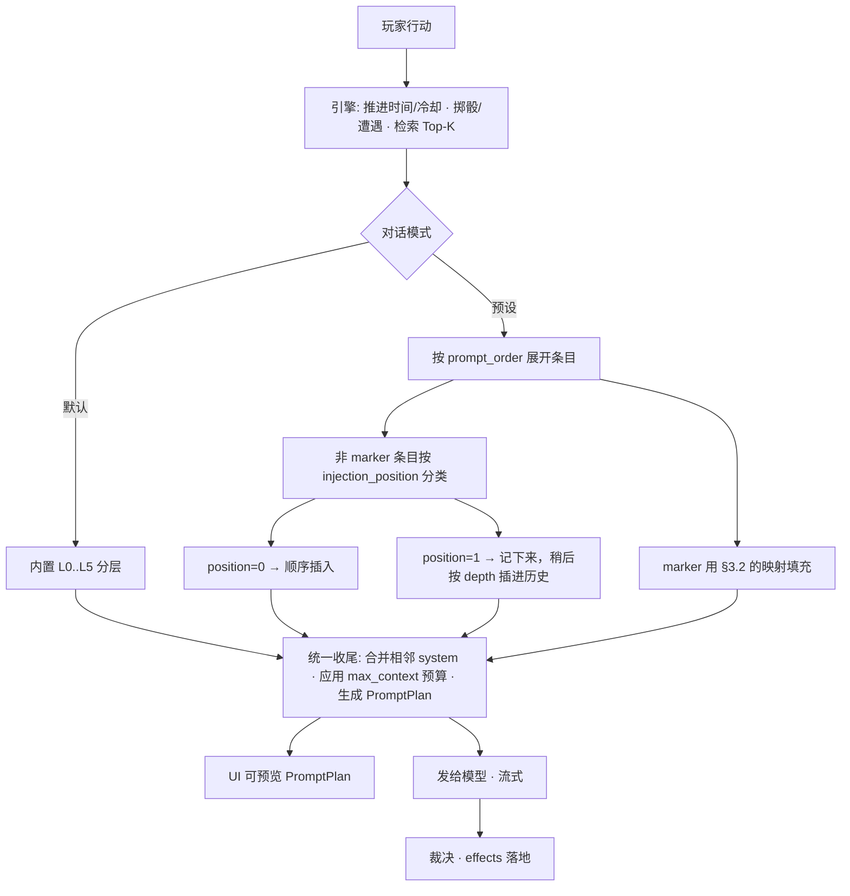

# 大模型对话：默认模式与 ST 预设系统 · 设计稿

> 版本：v0.1（**待确认，未实现**）　日期：2026-10-12
> 前置：[03 应用架构与实现](03-应用架构与实现.md)｜[05 技术架构设计](05-技术架构设计.md)
> 需求：对话部分支持**默认对话**与**预设**，预设采用 **SillyTavern 本地网页端**那一套。

---

## 0. 先说结论

- **默认模式** = 现在的引擎自有分层（L0 协议 → L1 世界法则 → L2 检索 → L3 状态摘要 → L4 近况 → L5 本回合）。开箱即用，不依赖任何外部文件。
- **预设模式** = 直接吃 **ST 的 Chat Completion 预设 JSON**（`SillyTavern/default/content/presets/openai/*.json`，实测 62 个顶层键、`prompts[]` 带 marker 占位、`prompt_order[]` 按 `character_id` 分组）。
- 两种模式**共用同一套引擎层**：无论选哪个，L1/L2/L3 这些"引擎事实"照常注入；预设改变的是**可编辑的指令文本、顺序、以及采样参数**。

**一个必须先说清的边界**：ST 里的"预设"其实有三样东西，我们只做第一种：

| ST 里的东西 | 是什么 | 我们 |
|---|---|---|
| **Chat Completion 预设** | `presets/openai/*.json`：提示词列表 + 顺序 + 采样参数 | ✅ **本设计的目标** |
| Context Template（上下文模板） | `presets/context/*.json`：决定消息怎么拼成 ChatML / Alpaca 等格式 | ❌ 不做。我们只发 OpenAI 的 `role: system/user/assistant`，由端点自己套模板 |
| Instruct Template（老版指令模式） | 单条 prompt 用 `### Instruction:` 之类包起来 | ❌ 不做（已过时，且与上面重复） |

---

## 1. ST Chat Completion 预设的事实（实测，不是我猜的）

来源：`SillyTavern/default/content/presets/openai/Default.json`（8000 字节）。

### 1.1 提示词列表

`prompts[]` 共 12 项，每项字段极简：

```json
{ "identifier": "main", "name": "Main Prompt", "system_prompt": true,
  "role": "system", "content": "Write {{char}}'s next reply in a fictional chat…" }
```

> `system_prompt` 这个布尔值的真实含义是**"内置条目还是用户自建条目"**（源码里用
> `system_prompt === false && !marker` 筛出用户自己加的 prompt）。所以：
> `true` = ST 自带、可一键重置为默认；`false` = 用户新增。导入时我们据此把后者标为可编辑。

实测这 12 项与它们的性质：

| identifier | name | role | marker | 说明 |
|---|---|---|---|---|
| `main` | Main Prompt | system | — | 主指令，用户最常改的一条 |
| `nsfw` | Auxiliary Prompt | system | — | 辅助/尺度指令 |
| `jailbreak` | Post-History Instructions | system | — | 插在历史**之后**的指令（相当于"越狱"/强约束） |
| `enhanceDefinitions` | Enhance Definitions | system | — | 默认禁用 |
| `dialogueExamples` | Chat Examples | — | ✅ | 占位：示例对话 |
| `chatHistory` | Chat History | — | ✅ | 占位：消息历史 |
| `worldInfoBefore` | World Info (before) | — | ✅ | 占位：世界书（前） |
| `worldInfoAfter` | World Info (after) | — | ✅ | 占位：世界书（后） |
| `charDescription` | Char Description | — | ✅ | 占位：角色描述 |
| `charPersonality` | Char Personality | — | ✅ | 占位：角色性格 |
| `scenario` | Scenario | — | ✅ | 占位：场景 |
| `personaDescription` | Persona Description | — | ✅ | 占位：用户人设 |

> **marker = true** 的条目是**占位符**：正文内容为空，ST 在组装时把动态数据塞到这个位置。
> 非 marker 的条目是**可编辑的固定文本**。

### 1.2 顺序

`prompt_order[]` 是**按 character_id 分组的数组**，实测两组：

```json
[ { "character_id": 100000, "order": [ {"identifier":"main","enabled":true}, … 11 项 ] },
  { "character_id": 100001, "order": [ … ] } ]
```

- 这两个数字是 ST 的 **`dummyId` 占位**（源码 `PromptManager.js:336` 用 100000、`openai.js:689` 用 100001）。
  一个用于普通聊天，一个用于群聊分组；**我们只需要前者**。
- **决策 D7**：只取 `character_id === 100000` 的那组；找不到就取第一组。

### 1.3 自定义条目（ST 支持，Default.json 里没有）

自定义条目额外带这些字段（在 `PromptManager.js` 的 Prompt 构造函数里实测出现）：
注意 ST **自带的**预设（`default/content/presets/openai/`）里全是内置条目、不带这些字段；
它们只在用户自己攒的预设里出现——而这恰恰是我们最需要支持的输入。
`injection_position`、`injection_depth`、`injection_order`、`injection_trigger`、`forbid_overrides`。

含义：`position = 0` 按顺序排；`position = 1` 则**按深度插进聊天历史里**（`depth` 表示"倒数第几条之前"），`injection_trigger` 是触发词（逗号分隔，命中才注入），`forbid_overrides` 表示禁止被别的同名条目覆盖。这是**有用且必须支持**的能力——它正是卡里"depth=4 插到历史里"那种效果的来源。

### 1.4 采样与运行参数（其余 50 个键）

实测 62 个顶层键，分组如下：

**A. 采样参数（我们会采纳）**
`temperature` `frequency_penalty` `presence_penalty` `top_p` `top_k` `top_a` `min_p` `repetition_penalty` `seed` `n` `openai_max_context` `openai_max_tokens`

**B. 消息处理（部分采纳）**
`names_behavior`（名字前缀策略）`squash_system_messages`（合并连续 system）`use_sysprompt`（是否用系统提示位）`assistant_prefill` `assistant_impersonation` `continue_prefill` `continue_postfix` `send_if_empty` `stream_openai`

**C. 固定文本片段（采纳，但只在与我们的功能重叠时才用）**
`impersonation_prompt` `new_chat_prompt` `new_group_chat_prompt` `new_example_chat_prompt` `continue_nudge_prompt` `group_nudge_prompt` `wi_format` `scenario_format` `personality_format`

**D. 供应商/模型选择（忽略）**
`chat_completion_source` `openai_model` `claude_model` `openrouter_*` `ai21_model` `mistralai_model` `chutes_*` `minimax_*` `electronhub_*` `custom_model` `custom_url` `custom_include_body` `custom_exclude_body` `custom_include_headers` `google_model` `vertexai_model` `reverse_proxy` `proxy_password` `show_external_models` `max_context_unlocked` `bias_preset_selected` `bypass_status_check` `media_inlining`

> **决策 D4**：忽略 D 组。模型名、baseUrl、请求头以**应用的「模型配置」为准**——预设是"怎么说话"，不是"跟谁说"。但 UI 会提示"该预设原本指向 X，已忽略"。

---

## 2. 数据模型

### 2.1 三层结构：原样保留 / 解析视图 / 生效配置

```
PresetFile（原始 JSON，逐字节保留所有字段，导出时不丢东西）
      │ parse
      ▼
Preset（我们理解的视图：entries[] / order[] / sampling / prompts片段 / warnings[]）
      │ resolve（应用选择 + 引擎层）
      ▼
PromptPlan（本回合真正要发的 messages[]，可在 UI 里预览）
```

关键点：**导入时不丢字段**。ST 的预设被别的客户端改过、加了新键，我们读不懂也要留着，导出时原样写回，避免"用我们的 App 存一次，预设就废了"。

### 2.2 本地存储

```
<config_dir>/presets/
├── index.json                 # 预设清单：id / 名称 / 来源 / 导入时间 / 是否内置
└── <presetId>.json            # 原始预设内容（原样）
```

- 归属：**本机配置**，与 `llm.json` 同级。
- **决策 D6**：**不进存档、不进 GitHub 同步**。理由：预设里可能含个人写的台词/癖好文本，同步到公开或共享仓库不合适；而且它不是"进度"。
- 明文存储（非密钥），无需加密。

---

## 3. 两种模式的语义

### 3.1 预设模式下，提示词完全由预设说了算（已确认：D1）

**已确认的决策 D1：不强制注入引擎协议。选「预设」模式时，发给模型的提示词就是预设展开的结果**，
不由我们塞 L0、不由我们改顺序、不由我们加禁令——玩家选预设，就按预设走。

| 层 | 默认模式 | 预设模式 |
|---|---|---|
| **L0 引擎协议** | 内置固定文本 | **不注入**（除非预设自己写了类似内容） |
| 预设条目 | 无 | `main` / `nsfw` / `jailbreak` / 自定义条目，按 `prompt_order` 展开 |
| **L1 世界法则** | 常驻条目 | **同一份**（由 `worldInfoBefore` / `worldInfoAfter` 两个 marker 决定插在哪） |
| **L2 检索记忆** | 本回合 Top-K | **同一份**（若预设没有 worldInfo marker，则追加在 L1 之后） |
| **L3 状态摘要** | `stateSummary()` | **同一份**（由 `personaDescription` / `scenario` marker 或默认位置承载） |
| L4 近况 | 最近 N 回合 | 由 `chatHistory` marker 决定位置（含 `injection_position/depth` 的深插条目） |
| L5 本回合 | 玩家行动 + 引擎裁定 | 同一份，永远最后 |
| 采样参数 | 应用设置 | 预设值优先（缺失则回落应用设置） |

**随之而来的两个后果，都必须处理（不是可选项）**：

1. **正文里可能出现状态标记**。实测：一旦没有"不许吐标记"的约束，模型就会照世界书里那份
   `<data_block>` 格式输出。我们**不再在提示词层面禁止**（那是预设的自由），但**显示层必须兜底**：
   `sanitizeNarrative()` 剥掉标记、流式期间遇到标记立即截断。这属于"渲染卫生"，不是对预设的限制。
2. **状态变更仍然要落地**。所以**裁决请求（effects 抽取）不走预设**——它是引擎与模型之间的
   内部协议，不是"对话"。预设只管叙事请求。否则游戏无法推进数值。

> 换句话说：**叙事提示词 = 预设说了算**；**渲染清洗 + 裁决抽取 = 引擎自有**。这两条不冲突。

### 3.2 marker 映射表（关键：我们不是角色卡，是游戏）

ST 的 marker 是为"角色卡"设计的，我们没有角色卡。映射方案：

| ST marker | 我们填什么 |
|---|---|
| `chatHistory` | 最近 N 回合滑窗（同默认模式 L4），受 `openai_max_context` 预算裁剪 |
| `worldInfoBefore` | L1 常驻法则（精简版） |
| `worldInfoAfter` | L2 检索命中的本回合设定 |
| `charDescription` | **叙事者设定**：一句话说明"你是本作的叙事引擎"（与 L0 呼应） |
| `charPersonality` | 文风要求（默认取内置文风句，可被预设覆盖） |
| `scenario` | 当前场景：`世界.当前时间 / 当前地点 / 危机程度` + 本回合引擎裁定（掷骰/遭遇结果） |
| `personaDescription` | 主角状态摘要：`stateSummary()`（境界、六维、灵根、气运、在场人物） |
| `dialogueExamples` | 空。我们不给示例对话（`{{char}}`/`{{user}}` 的示例写起来容易误导模型）。**决策 D2：默认留空，可在 UI 里手填** |

**决策 D2**：`{{char}}` = 叙事者「道渊」，`{{user}}` = 主角（用主角姓名替换）。这两个宏是 ST 生态里最常见的东西，映射错了整份预设都会跑偏，所以单列出来请你确认。

### 3.3 优先级与冲突

- `forbid_overrides`：ST 用它防"被覆盖"。我们简化为**同名条目后者不覆盖前者**；UI 标红提示重复。
- `injection_trigger`：命中才注入。我们按"本回合文本（玩家行动 + 近况）包含任一触发词"判定。
- 独立于模式：**`injection_position = 1`（按深度插入历史）在任何模式下都生效**——这是卡里那种"depth=4"效果的通用能力，值得支持。

---

## 4. 组装管线



**伪代码（要点）**

```js
function buildPromptPlan({ mode, preset, engine }) {
  const msgs = [];
  msgs.push({ role: 'system', content: L0_PROTOCOL });        // 不可覆盖

  if (mode === 'default') {
    msgs.push(...defaultLayers(engine));                       // L1..L3
    msgs.push(...recentTurns(engine));                         // L4
    msgs.push(engineTurnMessage(engine));                      // L5
    return { messages: msgs, warnings: [] };
  }

  // 预设模式
  const ordered = resolveOrder(preset);                        // 取 character_id=100000 的 order
  const deepInserts = [];
  for (const { identifier, enabled } of ordered) {
    if (!enabled) continue;
    const entry = preset.entries.findByIdentifier(identifier);
    if (!entry) { warn(`预设引用了不存在的条目 ${identifier}`); continue; }
    if (entry.marker) {
      const filled = FILLERS[identifier]?.(engine);            // §3.2 映射
      if (filled) msgs.push({ role: 'system', content: filled });
      continue;
    }
    if (entry.injection_trigger && !triggerHit(entry, engine)) continue;
    const text = renderMacros(entry.content, engine);           // §5
    if (entry.injection_position === 1) deepInserts.push({ ...entry, text });
    else msgs.push({ role: entry.role || 'system', content: text });
  }

  msgs.push(engineTurnMessage(engine, { deepInserts }));        // L5 永远最后
  return { messages: applyBudget(msgs, preset.sampling), warnings };
}
```

**`applyBudget`**：按 `openai_max_context` 裁历史、按 `openai_max_tokens` 设输出上限；裁的时候**永远先裁最老的对话回合**，L0 与 L1 不裁。

---

## 5. 宏支持表

ST 用 `{{...}}` 宏。我们对齐常用子集（参考掌上酒馆 `lib/core/prompt/macros.dart` 的支持面）：

| 宏 | 我们替换成 | 备注 |
|---|---|---|
| `{{char}}` | **「角色名」**字段（模型面板可填，默认 `道渊`） | **已确认 D2：按 ST 规范** |
| `{{user}}` | **「用户名」**字段（默认取主角姓名） | |
| `{{persona}}` | 主角一句话设定（出身/宗门/境界） | |
| `{{description}}` | 主角外观（容貌/身形/衣着） | |
| `{{personality}}` | 文风要求 | |
| `{{scenario}}` | 当前场景（时间/地点/危机） | |
| `{{time}}` / `{{date}}` | 游戏内时间（`世界.当前时间`）／第 N 日 | **注意**：用**游戏内**时间，不是真实系统时间 |
| `{{newline}}` | 换行 | |
| `{{pick a,b,c}}` | 随机取一（同种子可复现） | |
| `{{random a,b,c}}` / `{{roll 1d6}}` | 随机 / 掷骰 —— **已确认 D5：支持，用真随机**（贴 ST 行为） | |
| `{{noop}}` | 空 | |
| 其它未知宏 | **原样保留** + UI 告警 | 不静默清空，便于用户发现预设用了我们没实现的功能 |

---

## 6. UI 设计

### 6.1 「模型」面板新增一节

```
模型
├─ 接口预设        [OpenAI] [opencodego] [Ollama] [自定义]
├─ 接口地址 / 对话路径 / API Key / 附加请求头
├─ 叙事模型 / 温度 / top_p / max_tokens / 裁决模型
│
├─ 🆕 对话模式
│   ( ● ) 默认对话 —— 引擎内置分层，开箱即用
│   (   ) 使用预设   [ 未选择预设 ▾ ]   [管理预设…]
│        └ 选中时显示：来源 / 条目数 / 采样参数摘要（temperature 0.85 等）
│                       与应用的差异用金色标出「预设覆盖」
│
├─ [预览将发送的提示词]  ← 关键：能看到每一层的实际内容与 token 估算
└─ [保存] [测试·拉取模型] [清除 Key]
```

### 6.2 预设管理（抽屉/二级页）

```
预设管理
├─ [导入 JSON 文件] [粘贴 JSON] [从 ST 目录读取*]
├─ 列表：名称 · 条目 12 · 采样 8 项 · 来源 · 导入时间
│   └ 每项：[启用] [重命名] [复制] [导出] [删除]
└─ *「从 ST 目录读取」需要文件系统权限——**决策 D3**：见下

预设详情（点进某个预设）
├─ 采样参数（只列我们支持的 12 项；不支持的折叠显示为"已忽略"）
├─ 条目列表（可拖拽排序 = 改 prompt_order）
│   └ 每行：[✓启用] 名称 · role · [marker 标记] · [深度插入 d=4] · [编辑内容]
├─ 只读：未知字段 N 个已保留（导出时原样写回）
└─ [导出为 ST 预设 JSON]
```

### 6.3 提示词预览（重要）

预览面板显示**本回合真正发出去的 messages 序列**：

```
[1] system  引擎协议（不可覆盖）              128 tok
[2] system  Main Prompt（预设）               210 tok
[3] system  世界法则 · 常驻                    1412 tok
[4] system  本回合相关设定（检索 3 条）         1120 tok
[5] system  Post-History Instructions（预设）  96 tok
[6] user    近况: 初春·清晨…                   88 tok
[7] user    玩家行动：四处探索                  18 tok
                                          合计 3072 tok
```

这既是给用户的透明性，也是排查"预设没生效"的最快路径。

---

## 7. 兼容性边界（导入 ST 预设后，哪些生效）

| 会生效 | 不会生效（并给出提示） |
|---|---|
| `prompts[]` 的启用与顺序 | 各家的模型选择（`*_model`） |
| 条目文本、role、`system_prompt` | `custom_url` / `reverse_proxy` / `proxy_password` |
| 自定义条目的 `injection_position/depth/order/trigger` | Context Template（消息格式）与 Instruct Template |
| `temperature` `top_p` `top_k` `top_a` `min_p` `frequency_penalty` `presence_penalty` `repetition_penalty` `seed` | `n>1`（我们一次只取一条）、`media_inlining`、`bypass_status_check` |
| `openai_max_context` / `openai_max_tokens` | 群聊相关（`new_group_chat_prompt` / `group_nudge_prompt` / `character_id 100001`） |
| `squash_system_messages` / `use_sysprompt` / `names_behavior`（尽力） | 世界书条目自身的 ST 专属字段（我们的世界书是自己那份 319 条） |
| `wi_format` `scenario_format` `personality_format`（作为我们的模板串） | |

---

## 8. 实现拆解

| # | 内容 | 预估 |
|---|---|---|
| 1 | `preset/schema.js`：解析 + 校验 + 未知字段保留；单测覆盖 ST 真实预设 | 小 |
| 2 | `preset/store.js`：本地 CRUD（配置目录）+ 导入导出 | 小 |
| 3 | `preset/macros.js`：宏渲染表 + 未知宏保留告警；单测 | 小 |
| 4 | `narrator/plan.js`：**统一的 PromptPlan 组装**（默认/预设两条路走同一个出口）；单测断言层序、预算、marker 映射 | 中 |
| 5 | UI：模型面板的「对话模式」+ 预设管理 + 详情编辑 + 提示词预览 | 中 |
| 6 | 落库：预设随存档一起参与 `llm.json` 之外的本机配置；确认同步边界 | 小 |
| 7 | 端到端：真机导入一份 ST 预设 → 跑一回合 → 用预览核对 | 中 |

**与现有代码的接缝**：`narrator/prompt.js` 现在的 `composeNarrative` 会变成「默认模式」的实现，新加 `composeFromPreset`，两者都返回同一种 `PromptPlan`，`engine/turn.js` 只认 `PromptPlan`。改动面可控。

---

## 9. 决策记录（已确认 2026-10-12）

| # | 问题 | 结论 |
|---|---|---|
| **D1** | 引擎协议能否被预设覆盖 | **不强制，完全按预设**。预设模式不注入 L0；渲染清洗与裁决抽取仍归引擎（见 §3.1 的两条后果） |
| **D2** | `{{char}}` / `{{user}}` 映射 | **按 ST 规范**，并把两者做成模型面板里可填的字段：「角色名」（默认 `道渊`）、「用户名」（默认主角姓名） |
| **D3** | 是否扫描 ST 安装目录导入 | 先只做**文件导入 / 粘贴**（扫盘要文件权限，安卓体验差） |
| **D4** | 预设里的模型名 / baseUrl | **忽略**，以应用「模型配置」为准；UI 提示"该预设原本指向 X，已忽略" |
| **D5** | `{{random}}` / `{{roll}}` | **支持，用真随机**。注意：提示词单测因此不能断言随机宏的具体取值，只断言宏被替换 |
| **D6** | 预设是否参与 GitHub 同步 | **不参与**（可能含个人文本，且不是进度） |
| **D7** | `prompt_order` 多组取哪个 | 取 `character_id = 100000` 那组；无则取第一组 |
| **D8** | `dialogueExamples` 示例对话 | 默认**留空**，UI 可手填 |
| **D9** | 能否把默认模式导出成 ST 预设 | **做**（成本低，且能反向给 ST 用户用） |

## 10. 我不打算做的（避免误解）

- 不做 Context Template / Instruct Template（消息格式化模板）。
- 不做 ST 扩展脚本、Quick Replies、Regex 脚本在预设里的执行。
- 不做群聊语义（多 char 同时发言）。
- 不把预设文本当作"角色卡"来解析（我们只有《道渊》一个世界观）。

---

**确认后我就按第 8 节拆解实施，先落地 1–4（解析/存储/宏/组装 + 单测），再接 UI。**

## 11. 实现记录（落地时发现的、与设计稿的差异）

实现过程中被真实数据推翻或细化了几处，记录在此以免后人重新踩：

### 11.1 采样参数分成两份清单（设计稿只写了一份）

设计稿里 `SUPPORTED_SAMPLING` 是一份清单，实现时发现必须拆成两份：

- **`SUPPORTED_SAMPLING`（真会生效）**：`temperature` `top_p` `frequency_penalty`
  `presence_penalty` `seed` `openai_max_tokens` `openai_max_context`
  `squash_system_messages` `use_sysprompt` `names_behavior` `stream_openai`
  `assistant_prefill` `continue_prefill` `continue_postfix`
- **`KEPT_BUT_UNUSED_SAMPLING`（保留但不发送）**：`top_k` `top_a` `min_p`
  `repetition_penalty` `n`

原因：后一组不是 OpenAI 兼容端点的标准字段，**严格端点收到未知字段会直接 400**。
它们仍会被解析并显示在预设详情里（标为「已忽略」），但绝不进请求体。

### 11.2 常驻法则（L1）必须分层，否则会被程序化生成条目挤光

实测：L1 预算约 2240 字，而卡里 `constant` 条目的前几条是
`NPC人物生成规则`（802 字）、`秘境/遗迹生成`、`玄天界宗门生成`（963 字）、
`玄天界城市生成`（1831 字）——**它们把预算吃光，`境界` 与 `具体数值` 一条都进不去**。

而这类条目的本质是"教模型掷表生成 NPC/宗门/城市"，在独立版里已由
遭遇引擎（抽候选）与 fate（抽灵根/气运）接管，对模型纯属噪音。

修补两层：

1. **`CONSTANT_EXCLUDED`**：`*生成规则` / `*宗门生成` / `*城市生成` / `*人物生成`
   / `*遗迹生成` / `*动态人物相遇` 永不进提示词。
2. **`CONSTANT_TIERS` 分层排序**：tier 0 是每回合都要用的规则
   （境界/具体数值/DC/道心/时间/礼仪/灵根/战斗/器物/神识/核心规则/灵石体系），
   tier 1 是介绍类，tier 3 是元规则（`合理性审查` 三重人格——按主方案第 3.8 节保留，
   但降到最后且单独限量 25%，否则它单条 2604 字会独占预算）。

修补后 L1 实测收录到 `境界` / `礼仪` / `战斗` / `器物` / `神识`，而不是一堆生成规则。

### 11.3 顺手修掉的两个显示缺陷

- `stateSummary()` 重复拼接 DC（`炼气一层（DC:1）（DC:1）`）——境界标签本身已含 DC。
- HUD 同源问题（更早已修）。

### 11.4 验证情况

**已在真机（Pixel 6 / Android 14 / x86_64 模拟器）跑通**：

- 用系统文件选择器导入一份 ST 形状的预设 → 壳侧 `preset_import` 落盘
  （文件由应用自己创建，SELinux 上下文正确）→ 列表读到它 → 解析出
  条目/顺序组/采样 → 采样摘要里正确列出「已忽略 top_k / min_p / repetition_penalty」
  → 点「预览」看到完整提示词计划（含 `深度插入 d=2` 与 `missing-entry` 告警）。
- 顺带确认：`prompt()` 与 `<input type=file>` 在 Tauri 的安卓 WebView 上**都可用**
  （不需要额外插件）。

**本次未实现**：预设详情编辑器（拖拽排序、逐条改 role/内容、增删条目）。
当前用法是"在外部改好 JSON 再导入"。这是明确的未完项，也是下一步最该补的界面。
